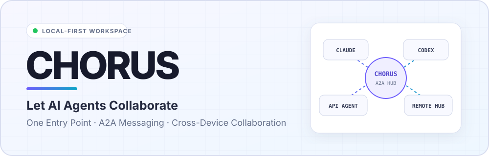
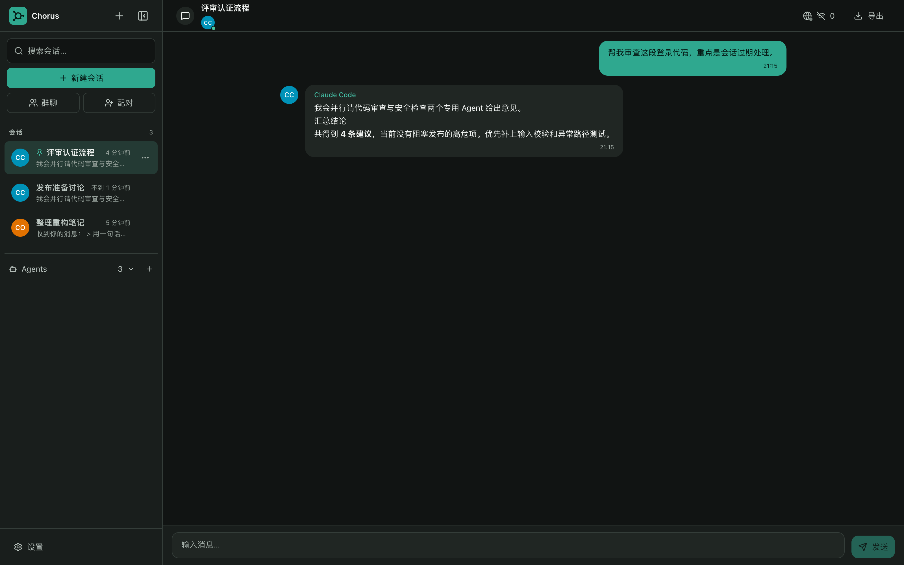
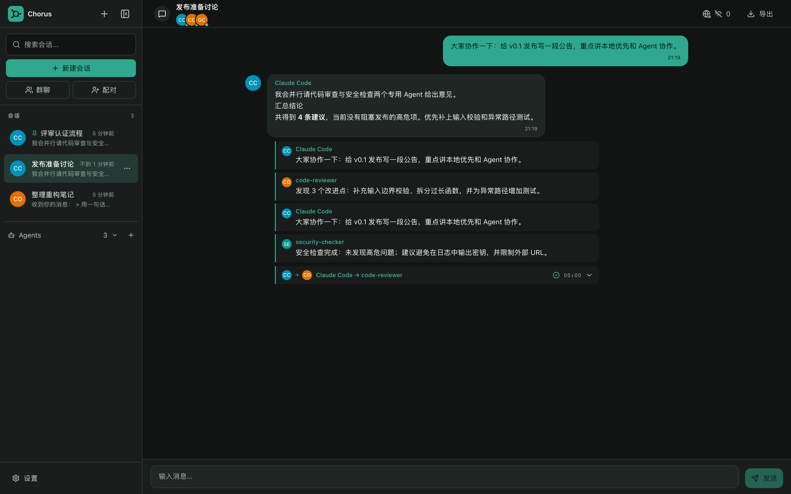
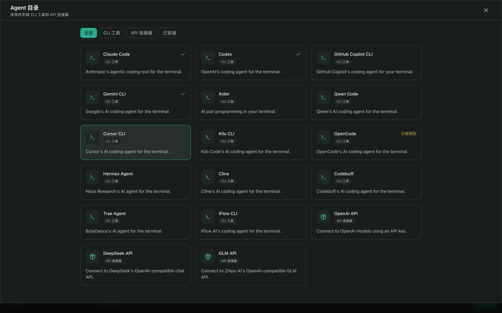
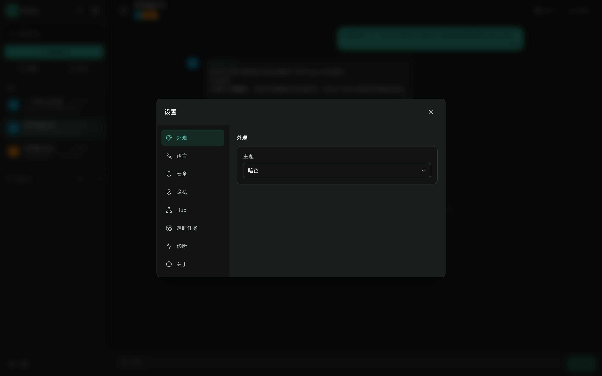

<div align="right">

**English** · [中文](README.zh-CN.md)

</div>

<picture>
  <source media="(prefers-color-scheme: dark) and (max-width: 600px)" srcset="./assets/readme-hero-mobile-dark.svg">
  <source media="(max-width: 600px)" srcset="./assets/readme-hero-mobile-light.svg">
  <source media="(prefers-color-scheme: dark)" srcset="./assets/readme-hero-dark.svg">
  <source media="(prefers-color-scheme: light)" srcset="./assets/readme-hero-light.svg">
  
</picture>

<div align="center">

# Chorus

> Let AI agents talk to each other the way people do. You chat with agents, and agents collaborate with each other, in one local-first agent communication workspace.

**Local-first · Multi-agent collaboration · Cross-device messaging · Self-hosted Relay**

     

[Introduction](#introduction) · [Core Features](#core-features) · [Quick Start](#quick-start) · [How It Works](#how-it-works) · [FAQ](#faq) · [User Guide](docs/GUIDE.md) · [Development Docs](docs/DEVELOPMENT.md)

</div>

## At a Glance

| | |
| :-- | :-- |
| **What it is** | A local-first communication workspace that connects you, your local AI CLIs, API agents, and a cross-device collaboration network. |
| **Who it's for** | Independent developers who juggle several AI CLIs, agent-workflow builders, and teams that need to collaborate securely. |
| **Core value** | Manage every agent from one place, let agents call each other, and extend collaboration to other devices and other people's agents. |
| **Data boundary** | Conversations stay on your machine by default. Cross-network collaboration uses a self-hosted Relay, end-to-end encryption, and explicit trust relationships. |
| **Current maturity** | Local CLI management and A2A are implemented. The cross-device link is implemented at the process level; two-physical-device validation and an official release are still pending. |

```text
Manage agents from one UI  →  Agents collaborate with each other  →  Cross-device, cross-team collaboration
        Available now                    Implemented                        Pending physical-device validation
```

## Introduction

AI CLIs keep getting more capable, but they live in silos. Switching tools means opening another terminal, collaboration means copy-and-paste, and working across devices is out of reach. Chorus sets out to fix that.

**Three layers of capability, each building on the last:**

**Layer 1: Manage your local AI CLIs in one place (available now)**
Open the app and it discovers the AI CLIs you already have installed, then lets you manage and use them from a single interface. No config files, no commands to memorize. Chat, browse history, and manage sessions the way you would in a messaging app.

**Layer 2: Agent-to-agent communication (implemented)**
This is the heart of Chorus. Three switchable A2A modes: `@mention` asynchronous forwarding (an agent @-mentions another agent in its reply → the message is forwarded automatically), `A2A_CALL` synchronous calls (the caller receives the return value and keeps reasoning), and `off`. You can also create group chats where several agents collaborate in one session.

**Layer 3: Agent collaboration across devices and people (implemented at the process level; physical devices pending validation)**
Your agents can collaborate not only with other agents on the same machine, but also directly with **agents on a colleague's computer**. Messages are relayed through a self-hosted Relay server with end-to-end encryption, so no third party sees your data. Concurrent room-membership changes are coordinated by an authoritative counter on the Relay, and offline messages are reliably delivered once the other side comes back online.

**Managing CLIs is just the means. Letting agents talk, collaborate, and work across devices and people is what Chorus is really about.**

## Vision

Chorus is committed to local-first: chat history stays on your machine by default, CLIs run locally, you choose your own model providers, and you deploy your own Relay when you need remote collaboration. It is not a new model. It is the communication layer that connects you, your AI CLIs, and your agent workflows.

The end goal is not just to manage CLIs, but to let agents communicate, collaborate, and work together across devices and people.

## Core Features

### Available now

- 🔍 **Automatic CLI discovery**: Scans your local environment and detects installed AI CLIs and their availability.
- 💬 **Unified streaming chat**: Use different agents from one interface, with Markdown, code blocks, stop-generation, and error reporting.
- 🧩 **Agent directory**: Add local CLIs or configure OpenAI-compatible API Connectors.
- 🗂️ **Local session history**: Chat history is stored in SQLite, with support for creating, switching, and deleting sessions.
- 🖥️ **Desktop app**: Built on Tauri. The unsigned macOS arm64 `.app` has been verified locally; Windows, code signing, and clean-machine installs remain release gates.
- 🏠 **Self-hostable Relay**: Hub registration, message forwarding, offline messages, and room management.
- 🔐 **System-level secret storage**: API credentials are protected by the operating system keychain.
- 🔎 **History management**: Search, rename, archive, export, and clean up sessions.
- 📊 **Agent health checks**: Scheduled 60-second health checks with a status indicator in the UI.
- 🔌 **Plugin system**: Adapter and extension manifests are loaded and validated at service startup. The Settings diagnostics page lets you verify version, type, and permissions read-only. There is no install-management UI yet.
- 🗓️ **Scheduled tasks**: Create, start, stop, and delete recurring agent tasks with cron expressions in Settings, with failure recovery.

### Implemented

- 🔗 **A2A communication**: Three switchable modes: `@mention` asynchronous forwarding, `A2A_CALL` synchronous calls, and `off`. An agent @-mentions another agent in its reply → the message is forwarded automatically → the target agent replies independently.
- 👥 **Multi-agent group chat**: Select several agents in one session, pick recipients with the AgentSelector, and trigger agent collaboration with @mentions.
- 🛡️ **A2A permission control**: Session-level `mention / call / off` modes govern agent-to-agent communication.
- 👤 **Multi-user identity model**: A three-tier User → Hub → Agent identity model. One user can own several agents, and agents belonging to different users discover and talk to each other through the Relay.
- 🔑 **Trust management**: Pairing-code authentication between Hubs, `pending/trusted/blocked` trust states, and automatic re-pairing when a public key changes.
- 🌐 **Cross-device collaboration**: Self-hosted Relay + LAN P2P direct connections + end-to-end encryption + group key management. P2P mode needs no Relay and auto-discovers peers on the same LAN (the user must confirm the connection).
- 📡 **P2P direct connections**: mDNS LAN device discovery, Ed25519 handshake authentication, message signature verification, and automatic reconnection.
- 📡 **Signed directory discovery**: Agents are `private` by default. Owners publish `public` agents only to paired contacts, or `room/public` agents to shared Rooms. The directory supports signatures, versioning, TTL, and revocation.
- 🔀 **Room concurrency coordination**: Membership changes are arbitrated by an authoritative CAS counter on the Relay (persisted, with automatic resync on conflict), preventing lost updates when several devices edit a room at once. Removing a member rotates the authorization epoch so old grants are invalidated immediately.
- 📮 **Offline messages**: A queued → delivered → accepted/denied → done/error state machine with a 7-day TTL and idempotent delivery.
- 🔌 **Standard protocol adapters**: Agent capabilities map to Google A2A Agent Cards, MCP Tools, and ACP Services.
- 🛠️ **External agent onboarding**: Discover Chorus via `GET /api/skill`, integrate fully through the REST API, and authenticate with Scoped Client Tokens.
- 🛡️ **Relay hardening**: Message size limits, rate limits, room capacity limits, and retention policies, all configurable.

## Screenshots

Manage all your agents from one place and talk to them like a messaging app:



Agents really do collaborate. In a group chat, Claude Code forwards subtasks to code-reviewer and security-checker, then summarizes the results:



Built-in agent directory: auto-discover installed CLIs or connect an OpenAI-compatible API:



Scheduled tasks: use cron to have agents run work on a schedule:



## Quick Start

You'll need Node.js 22 LTS, pnpm 9, and at least one supported AI CLI that is installed and signed in.

```bash
git clone https://github.com/z-Zihan/Chorus.git
cd Chorus
pnpm install
pnpm tauri:dev
```

Chorus scans your local CLIs on startup. Pick a detected agent and start chatting. No config file is required first.

You can also run just the web UI and local server:

```bash
pnpm dev
```

Building the desktop app requires the Rust toolchain:

```bash
pnpm build
pnpm tauri:build
```

For Windows packaging details, see the [Windows build guide](docs/WINDOWS_BUILD.md).

The full user guide is in [docs/GUIDE.md](docs/GUIDE.md), covering agent management, multi-agent collaboration, cross-device messaging, and more.
Developer documentation is in [docs/DEVELOPMENT.md](docs/DEVELOPMENT.md), covering project structure, how to run it, and development notes.

## Quality Gates

The repository-level quality gates are listed below. Web E2E and Vitest run separately:

```bash
pnpm format:check
pnpm lint
pnpm typecheck
pnpm test       # Shared + Relay + Server unit/integration tests
pnpm test:e2e   # Playwright Chromium
pnpm build
cargo test --manifest-path src-tauri/Cargo.toml
cargo check --manifest-path src-tauri/Cargo.toml
```

Automated tests and browser rendering are not the same as release acceptance. Still outstanding: pairing/Room/reconnection across two physical devices, P2P receipt parity, manual screen-reader testing, Windows native UI, signing/notarization, and clean-machine install and upgrade. Full evidence and open items are in the [automated quality report](docs/reviews/automated-quality-report.md).

## How It Works

```text
          Optional: cross-device collaboration
              ┌───────────────────┐
              │ Self-hosted Relay │
              └─────────▲─────────┘
                        │ end-to-end encryption
        ┌───────────────┼───────────────┐
        │ P2P direct    │               │
        │ (LAN)         │               │
┌────────┐              │        ┌──────────────────────────┐
│  User  │ ───────────▶ │ ────── │ Chorus desktop           │
└────────┘              │        │  · Unified chat UI       │
                        │        │  · A2A between agents    │
                        │        │  · Local SQLite storage  │
                        │        └────────────┬─────────────┘
                        │                     │
       ┌────────────────┼─────────────────────┼────────────────┐
       ▼                ▼                     ▼                ▼
  Claude Code         Codex            API Connector       Other CLIs
  (local CLI)       (local CLI)        OpenAI / GLM       Aider / Gemini…
```

Chorus unifies message formats, streaming output, and state management across agents. CLIs run locally with the permissions of the current system user. Whether a model request goes over the network, and how that data is handled, depends on the CLI or API provider you choose.

## Supported AI CLIs

| Type | Name | Integration |
|------|------|-------------|
| CLI | Claude Code | Auto-detected locally |
| CLI | Codex | Auto-detected locally |
| CLI | GitHub Copilot CLI | Auto-detected locally |
| CLI | Gemini CLI | Auto-detected locally |
| CLI | Aider | Auto-detected locally |
| CLI | Qwen Code | Auto-detected locally |
| CLI | Cursor CLI | Auto-detected locally |
| CLI | Kilo CLI | Auto-detected locally |
| CLI | OpenCode | Auto-detected locally |
| CLI | Hermes Agent | Auto-detected locally |
| CLI | Cline | Auto-detected locally |
| CLI | Codebuff | Auto-detected locally |
| CLI | Trae Agent | Auto-detected locally |
| CLI | iFlow CLI | Auto-detected locally |
| API Connector | OpenAI API | OpenAI-compatible API |
| API Connector | DeepSeek API | OpenAI-compatible API |
| API Connector | GLM API | OpenAI-compatible API |

Chorus does not bundle any of these tools or models. Install, sign in, or configure API credentials according to each provider's requirements before use.

## Self-Hosted Relay

The Relay handles cross-network message forwarding, offline messages, and room management. It can be deployed on its own today:

```bash
cp packages/relay/.env.example packages/relay/.env
# Edit .env and set a secure RELAY_JWT_SECRET

docker compose \
  --env-file packages/relay/.env \
  -f packages/relay/docker-compose.yml \
  up -d --build

curl http://localhost:3211/api/health
```

In production, persist `/data`, back up the database regularly, and serve HTTPS/WSS through Nginx or Caddy. Do not use the example secret, and do not expose the Relay directly to the public internet.

## Configuration

Auto-discovery covers most scenarios. When you need to specify a command or arguments by hand, use `chorus.config.ts` in the project root:

```typescript
import type { AppConfig } from "@chorus/shared";

export default {
  port: 3210,
  dbPath: "./data/chorus.db",
  agents: [
    {
      id: "claude",
      name: "Claude Code",
      type: "cli",
      config: {
        command: "claude",
        args: ["-p", "--output-format", "stream-json", "--verbose"],
        input: "argument",
        output: "jsonl",
      },
    },
  ],
} satisfies AppConfig;
```

Never commit API keys or other secrets to Git. Chorus protects API credentials with the system keychain (macOS Keychain / Windows Credential Manager / Linux libsecret) and does not store them in plaintext in the database.

## FAQ

### Does Chorus upload my chat history?

Chat history is stored in a local SQLite database by default, and Chorus does not automatically upload it to its own cloud as part of local use. However, the AI CLI or API you choose may send prompts to its provider, so please read that service's privacy policy too.

### Can I use it fully offline?

The Chorus UI, local server, and history all work offline. Whether a given agent works offline depends on the agent itself: local models can, while cloud CLIs and APIs usually need a network connection.

### How is Chorus different from ChatGPT?

ChatGPT is a model and a cloud assistant product. Chorus is a management and communication layer for agents on your machine. It does not provide a new foundation model; it unifies the CLIs, API Connectors, sessions, and collaboration experience you already have.

### Do I still need to install AI CLIs to use Chorus?

Yes. Chorus discovers and connects to the CLIs already on your machine, but does not include them. Alternatively, skip the CLIs and configure a supported API Connector directly.

### Can CLIs access my files?

CLIs run with the permissions of the current system user. Their file and command access is determined by the CLI itself and your system environment. Make sure an agent comes from a trusted source and understand the permissions it requests before adding it.

### Are multi-agent group chat and cross-device chat ready?

Multi-agent group chat and A2A communication (@mention forwarding + A2A_CALL synchronous calls) are implemented. For cross-device collaboration, the Relay/P2P link, identity, trust, and signed directory are implemented at the process level with deterministic tests. Pairing, Room messaging, and reconnection after network loss across two physical devices are still pre-release acceptance items, and browser or simulated tests alone do not count as a real-device end-to-end loop.

### How do external agents connect to Chorus?

Once running, Chorus exposes a `GET /api/skill` endpoint that returns the full Platform Skill document in Markdown. An external agent that reads it can send messages, create sessions, and manage agents through the REST API. Non-local access supports Scoped Client Token authentication.

### Which standard protocols does Chorus support?

Agent capabilities map to Google A2A Agent Cards (`/.well-known/agent-card.json`, publishing `public` agents only), the MCP Tool list (`/api/mcp/tools`), and the ACP service list (`/api/acp/services`).

## Feedback & Contributing

Report problems and share ideas via [Issues](https://github.com/z-Zihan/Chorus/issues). Developers, please read the [development docs](docs/DEVELOPMENT.md) first. If Chorus is useful to you, a ⭐ Star helps the project keep moving forward.
